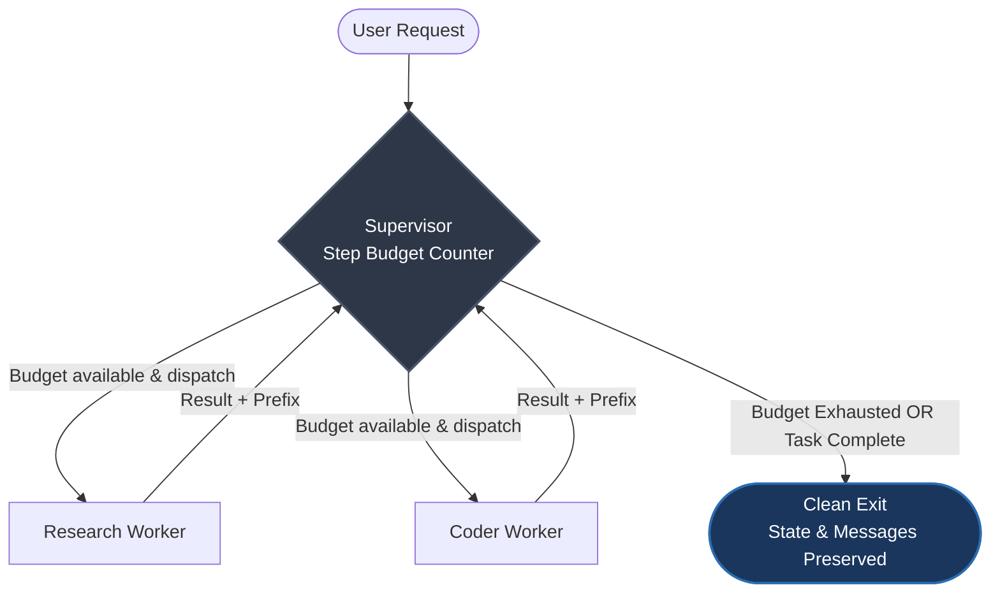

<div align="center">

# 🧠 Pattern Hub

**Small, battle-tested AI-agent architecture patterns that run out-of-the-box.**  
*Zero API keys required • Verified with unit tests • Copy-paste ready*

[](LICENSE)
[](pyproject.toml)
[](https://docs.astral.sh/uv/)
[](https://github.com/langchain-ai/langgraph)
[](patterns/langgraph-supervisor/tests)

[Quickstart](#-quickstart-in-60-seconds) • [Why Pattern Hub?](#-why-pattern-hub) • [Featured Pattern](#-featured-pattern-bounded-supervisor) • [Pattern Catalog](#-pattern-catalog) • [Contributing](#-contributing-a-pattern)

</div>

---

## 💡 Why Pattern Hub?

Most multi-agent tutorials suffer from three problems:
1. **They require expensive API keys** just to inspect graph control flow.
2. **They omit failure boundaries**, leaving agents vulnerable to runaway loops and lost state.
3. **They lack tests**, making it unclear how the architecture behaves when edge cases hit.

**Pattern Hub provides isolated, runnable architectural blueprints** with deterministic worker mocks and full `pytest` suites verifying every claim.

---

## ⚡ Quickstart (In 60 Seconds)

All patterns use [uv](https://docs.astral.sh/uv/) for instant, virtualenv-free execution. No API keys needed.

### 1. Install `uv` (if not already installed)

```bash
# macOS / Linux
curl -LsSf https://astral.sh/uv/install.sh | sh

# Windows (PowerShell)
powershell -ExecutionPolicy ByPass -c "irm https://astral.sh/uv/install.ps1 | iex"
```

### 2. Clone and run the Bounded Supervisor

```bash
git clone https://github.com/psuvraneel-cyber/pattern-hub.git
cd pattern-hub/patterns/langgraph-supervisor
uv run main.py
```

`uv` downloads the exact Python runtime and dependencies automatically.

---

## 🎯 Featured Pattern: Bounded Supervisor

> [!WARNING]
> In **LangGraph 1.2+**, the default `recursion_limit` is **10,007 steps** (up from 25 in earlier versions).  
> If an agent gets stuck in a loop, it consumes thousands of LLM calls until it crashes with `GraphRecursionError` — **and all accumulated state is lost.**

### The Problem vs. The Solution

| Behavior | Default LangGraph | Bounded Supervisor Pattern |
|:---|:---|:---|
| **Looping Worker** | Loops up to 10,007 times | Stops strictly at `max_steps` |
| **On Limit Reached** | Raises `GraphRecursionError` | Exits cleanly with status code `0` |
| **Collected Work** | ❌ **Wiped out entirely** | ✅ **100% preserved in state** |
| **API Cost Exposure** | Uncapped disaster | Strict hard budget |



### Console Output Comparison

When running `uv run main.py`, you will see all three execution modes compared:

```console
== normal task, max_steps=6
   -> clean exit after 9 supersteps, 5 messages kept
== stubborn worker, max_steps=6
   -> clean exit after 13 supersteps, 7 messages kept
== stubborn worker, no budget (recursion_limit=25)
   -> GraphRecursionError after 25 supersteps. The run is lost.
```

---

## 🧪 Testing & Formal Verification

Patterns ship with test suites that empirically prove their architectural guarantees.

```bash
# Run the test suite
cd patterns/langgraph-supervisor
uv run --group dev pytest -v
```

### The Budget Formula

- Every round trip costs **2 supersteps** (1 supervisor decision + 1 worker execution).
- A final supervisor evaluation step is required to terminate.
- Total supersteps for a budget of $N$ = $2N + 1$.
- `recursion_limit` also counts the initial input state step, meaning it must be configured to at least:

$$\text{recursion\_limit} \ge 2N + 2$$

The test `test_recursion_limit_must_be_at_least_2x_max_steps_plus_2` verifies this invariant against LangGraph's internal engine.

---

## 🔌 Swapping Mocks for Real Models

The patterns are built as drop-in scaffolds. To connect a live LLM (e.g. Claude, GPT-4o, or Gemini), swap the mock worker in `workers.py`:

```bash
uv add anthropic
```

```python
import anthropic
from state import AgentState

client = anthropic.Anthropic()

def research(state: AgentState) -> dict:
    response = client.messages.create(
        model="claude-3-7-sonnet-latest",
        max_tokens=2048,
        messages=[{"role": "user", "content": "\n".join(state["messages"])}],
    )
    return {"messages": [f"research: {response.content[0].text}"]}
```

> [!TIP]
> **Keep message prefixes:** The supervisor inspects message prefixes (e.g., `research:`, `code: done`) to route control flow deterministically.

---

## 📚 Pattern Catalog

| Pattern | Framework | Key Benefit | Status |
|:---|:---:|:---|:---:|
| [**langgraph-supervisor**](patterns/langgraph-supervisor) | LangGraph | Graceful step budget termination & state rescue |  |
| *parallel-evaluator* *(planned)* | LangGraph / Any | Fan-out synthesis with token-budget fallback |  |
| *human-in-the-loop-timeout* *(planned)* | LangGraph | Async resumption with interrupt timeout guarantees |  |

---

## 🤝 Contributing a Pattern

Have an agent pattern that solves a hard production edge case? Contributions are welcome!

Every pattern must satisfy three criteria:
1. **Self-contained**: Placed under `patterns/<pattern-name>` with its own `pyproject.toml`.
2. **Zero-API-key default**: Must run with deterministic mock workers out-of-the-box.
3. **Tested**: Must include a `tests/` folder proving both the happy path and the failure modes.

---

## 📄 License

This project is licensed under the [MIT License](LICENSE).
