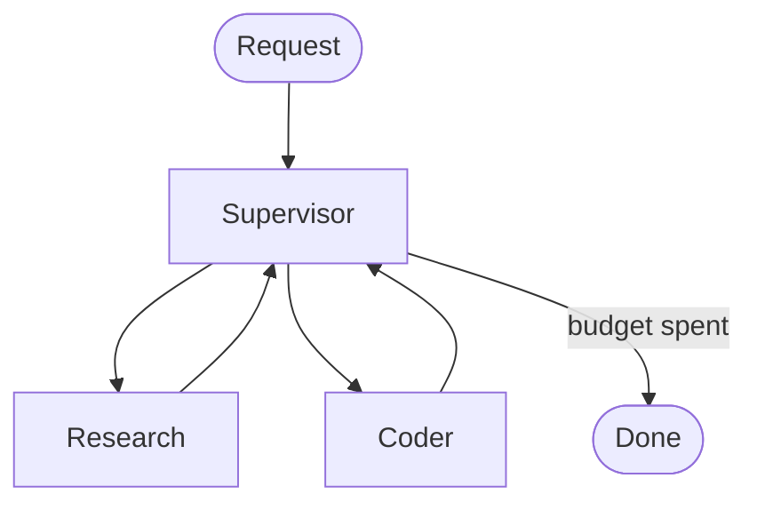

# Bounded Supervisor (LangGraph)

LangGraph's `recursion_limit` stops a looping graph by raising `GraphRecursionError`, and the run is lost. This pattern gives the supervisor a step budget in state, so it stops on purpose and returns everything the workers did so far. `recursion_limit` stays on as the backstop.



Workers never call each other. Every hop returns to the supervisor, so one counter bounds the whole graph.

## Run it

Needs [uv](https://docs.astral.sh/uv/). No API key: the workers are deterministic mocks.

```bash
cd patterns/langgraph-supervisor
uv run main.py
```

It runs three cases:

| Case | Result |
|---|---|
| Normal task, `max_steps=6` | Finishes on its own after 9 supersteps |
| Worker that never finishes, `max_steps=6` | Clean exit after 13 supersteps, all 6 worker messages kept |
| Same worker, no budget, `recursion_limit=25` | `GraphRecursionError`. The run is lost |

## Tests

```bash
uv run --group dev pytest
```

The tests check every claim above against real LangGraph.

## Why set recursion_limit yourself

In LangGraph 1.2 the default `recursion_limit` is **10,007** (older versions used 25). With no limit set, a loop that never finishes runs 10,007 supersteps, about 5,000 worker calls, before `GraphRecursionError`. `test_default_recursion_limit_lets_a_loop_run_10007_steps` checks this.

## The budget math

- Each hop costs 2 supersteps (supervisor + worker), plus 1 final supervisor step to exit.
- So `max_steps=N` uses `2N + 1` supersteps.
- `recursion_limit` also counts the input step, so set it to at least `2N + 2`, or the backstop fires before your budget does. `test_recursion_limit_must_be_at_least_2x_max_steps_plus_2` pins this down.

## Files

| File | What it is |
|---|---|
| `state.py` | `AgentState`: messages plus `step_count` and `max_steps` |
| `supervisor.py` | `route()` picks the next worker; `supervisor()` enforces the budget |
| `workers.py` | Mock research and code workers, plus a "stubborn" worker that never finishes |
| `graph.py` | Wires the graph |
| `main.py` | Runs the three cases above |

## Using real LLMs

Replace the functions in `workers.py` (and `route()` if you want an LLM router) with LLM calls. The supervisor and the budget don't change.

Tested with LangGraph 1.2.20 on Python 3.14.
